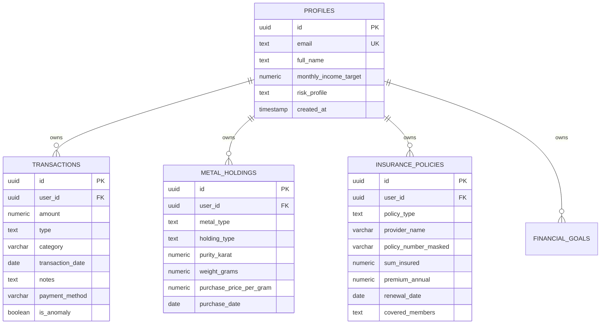

# FINBUD Database Documentation

## 1. Schema Overview

The database is deployed on **Supabase PostgreSQL** with full **Row-Level Security (RLS)**.



## 2. Row-Level Security Rules

Every table containing user data implements:
```sql
ALTER TABLE public.transactions ENABLE ROW LEVEL SECURITY;
CREATE POLICY "Users can manage own transactions" ON public.transactions
    FOR ALL USING (auth.uid() = user_id);
```

This guarantees multi-tenant data isolation at the PostgreSQL storage engine level.

