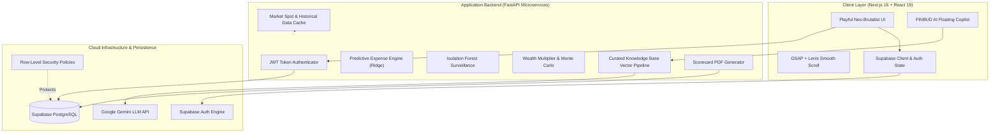

# FINBUD System Architecture

## 1. System Overview

FINBUD is a full-stack, AI-augmented personal wealth management platform designed for the Indian economic and regulatory landscape.

## 2. Component Architecture

### Frontend (Next.js Turbopack)
- **Framework:** Next.js 16.4.6 with React 19.
- **Styling:** Neo-Brutalism using Tailwind CSS v4, custom utility classes (`.neo-card`, `.neo-btn-primary`, `.neo-btn-yellow`), and Google `Plus Jakarta Sans`.
- **Smooth Animation:** Lenis momentum scrolling synchronized with GSAP tickers.
- **Charts:** Recharts with custom SVG gradients and neo-brutalist tooltip cards.

### Backend (FastAPI)
- **Framework:** FastAPI with Python 3.11.
- **Authentication:** `get_current_user` extracts and cryptographically validates Supabase Bearer tokens.
- **ML Services:** Scikit-learn Ridge regression and Isolation Forest.
- **Reporting:** ReportLab PDF generator rendering audit scorecards with INR currency formatting.

### Security
- **Row-Level Security (RLS):** Every user can only access rows where `user_id == auth.uid()`.
- **Server-Side Aggregation:** PDF endpoint computes all financial totals on the server from Supabase records.

